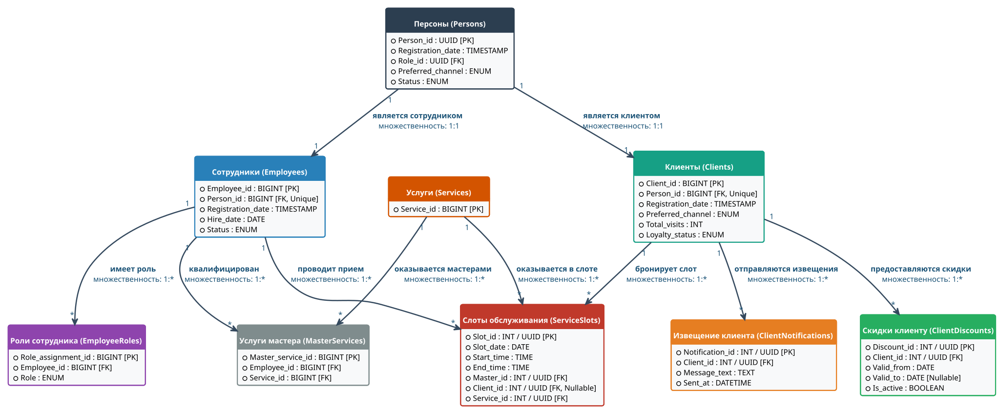

# Расширенная модель предметной области (Extended Model)

В данной директории представлена расширенная версия диаграммы классов информационно-сервисной системы барбершопа, дополненная модулями персонализированного маркетинга и омниканальных коммуникаций.

## Новые сущности

1. **Скидки клиенту (`ClientDiscounts`)**
   - Учет персональных предложений, промо-акций и программ лояльности.
   - Поддержка процентных скидок (`PERCENT`) и скидок с фиксированной суммой (`FIXED_AMOUNT`).
   - Контроль периода действия (`valid_from`, `valid_to`) и флаг активности (`is_active`).
   - Связь: `Client "1" --> "*" ClientDiscount` (мощность 1:*).

2. **Извещения клиента (`ClientNotifications`)**
   - Журналирование и управление отправкой уведомлений клиентам.
   - Поддержка каналов коммуникации: Telegram, WhatsApp, VK, SMS.
   - Контроль статуса отправки (`PENDING`, `SENT`, `FAILED`) и фиксация диагностических ошибок (`error_message`).
   - Связь: `Client "1" --> "*" ClientNotification` (мощность 1:*).

## Диаграммы

- Исходный код PlantUML: [`class_diagram.puml`](class_diagram.puml)
- Векторная схема (SVG): [`class_diagram.svg`](class_diagram.svg)
- Растровое изображение высокого разрешения (PNG): [`class_diagram.png`](class_diagram.png)

