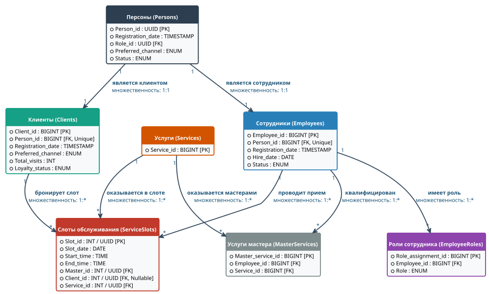
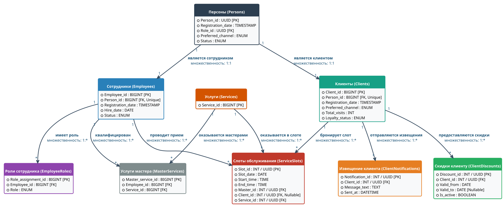

# 💈 Barbershop CRM & Booking System — UML Domain Model

[](https://www.omg.org/spec/UML/)
[](https://plantuml.com/)
[](#архитектурные-решения-и-паттерны)
[](schema.sql)

Репозиторий содержит концептуальную и логическую модель данных информационной системы автоматизации процессов барбершопа (салона услуг). В проекте представлены UML-диаграммы классов, спецификация сущностей, матрица отношений с мощностями (cardinality), обоснование проектных решений, а также готовый SQL DDL-скрипт.

---

## 📌 Оглавление

1. [Обзор предметной области](#-обзор-предметной-области)
2. [Поддерживаемые сценарии использования (Use Cases)](#-поддерживаемые-сценарии-использования-use-cases)
3. [Диаграммы классов UML](#-диаграммы-классов-uml)
   - [Базовая модель (Ex00 — Ex03)](#базовая-модель-ex00--ex03)
   - [Расширенная модель (Extended / Ex05)](#расширенная-модель-extended--ex05)
4. [Словарь сущностей (Data Dictionary)](#-словарь-сущностей-data-dictionary)
5. [Матрица связей и мощность (Multiplicity)](#-матрица-связей-и-мощность-multiplicity)
6. [Архитектурные решения и паттерны](#-архитектурные-решения-и-паттерны)
7. [Реализация в реляционной СУБД (DDL)](#-реализация-в-реляционной-субд-ddl)
8. [Инструкция по сборке и генерации схем](#-инструкция-по-сборке-и-генерации-схем)
9. [Структура репозитория](#-структура-репозитория)

---

## 🎯 Обзор предметной области

Информационная система предназначена для автоматизации работы современного барбершопа:
- Централизованный учет физических лиц (пользователей системы), разделение клиентской базы и персонала;
- Управление квалификацией сотрудников и каталогом оказываемых услуг;
- Формирование рабочего графика мастеров с дискретными временными слотами обслуживания;
- Онлайн-бронирование визитов клиентами и регистрация записей менеджерами;
- Управление скидками, акциями и персональной лояльностью;
- Омниканальное информирование клиентов (SMS, Telegram, WhatsApp, VK).

---

## 📋 Поддерживаемые сценарии использования (Use Cases)

- **UC01 — Регистрация и аутентификация**: создание учетной записи персоны менеджером или пользователем, назначение роли, валидация контактов, генерация хэша пароля.
- **UC02 — Выбор мастера и бронирование слота**: фильтрация доступных мастеров по роли `Master`, поиск свободных временных слотов на дату, фиксация брони за клиентом.
- **UC03 — Формирование расписания и каталога услуг**: привязка компетенций мастера к услугам (`MasterServices`), просмотр расписания мастером, выбор клиентом допустимой услуги.
- **UC04 — Автоматические извещения**: отправка сервисных уведомлений при регистрации, бронировании или изменении статуса слота через предпочтительный канал клиента.
- **UC05 — Применение программ лояльности и скидок**: расчет итоговой стоимости обслуживания с учетом персональных скидок (`ClientDiscounts`) и статуса лояльности клиента.

---

## 📊 Диаграммы классов UML

### Базовая модель (Ex00 — Ex03)

Диаграмма охватывает основные сущности: физические лица, клиенты, сотрудники, ролевая модель, каталог услуг, матрица квалификаций и слоты обслуживания.

- **Векторный формат**: [class_diagram.svg](class_diagram.svg)
- **Исходный код**: [class_diagram.puml](class_diagram.puml)



---

### Расширенная модель (Extended / Ex05)

Расширенная версия включает дополнительные функциональные модули:
- **`ClientDiscounts`**: персональные и акционные скидки с гибким периодом действия.
- **`ClientNotifications`**: журнал отправки омниканальных сообщений и статус доставки.

- **Директория**: [`Extended/`](Extended/)
- **Векторный формат**: [Extended/class_diagram.svg](Extended/class_diagram.svg)
- **Исходный код**: [Extended/class_diagram.puml](Extended/class_diagram.puml)



---

## 📖 Словарь сущностей (Data Dictionary)

### 1. `Persons` (Персоны)
Централизованный реестр всех физических лиц (клиентов, мастеров, администраторов).
| Атрибут | Тип | Ключ / Модификатор | Описание |
| :--- | :--- | :--- | :--- |
| `person_id` | `UUID` | **PK** | Уникальный идентификатор персоны |
| `login` | `VARCHAR(50)` | **Unique**, `NOT NULL` | Уникальный логин для входа в систему |
| `password_hash` | `VARCHAR(255)` | `NOT NULL` | Хэш пароля с солью |
| `first_name` | `VARCHAR(50)` | `NOT NULL` | Имя персоны |
| `patronymic` | `VARCHAR(50)` | `Nullable` | Отчество (при наличии) |
| `phone_number` | `VARCHAR(12)` | **Unique**, `NOT NULL` | Номер телефона в международном формате (+7XXXXXXXXXX) |
| `registration_date` | `TIMESTAMP` | `NOT NULL` | Дата и время создания учетной записи |
| `role_id` | `UUID` | **FK** | Ссылка на базовую роль |
| `preferred_channel` | `ENUM` | `NOT NULL` | Канал связи (`SMS`, `Telegram`, `WhatsApp`, `VK`) |
| `status` | `ENUM` | `NOT NULL` | Статус аккаунта (`ACTIVE`, `BLOCKED`, `PENDING`) |

### 2. `Clients` (Клиенты)
Профиль клиента с параметрами программы лояльности и предпочтениями.
| Атрибут | Тип | Ключ / Модификатор | Описание |
| :--- | :--- | :--- | :--- |
| `client_id` | `BIGINT` | **PK** | Идентификатор профиля клиента |
| `person_id` | `BIGINT` | **FK**, **Unique** | Ссылка на персону (отношение 1:1) |
| `registration_date` | `TIMESTAMP` | `NOT NULL` | Дата регистрации в качестве клиента |
| `preferred_channel` | `ENUM` | `NOT NULL` | Приоритетный канал для уведомлений |
| `total_visits` | `INT` | `NOT NULL`, `DEFAULT 0` | Счетчик завершенных визитов |
| `loyalty_status` | `ENUM` | `NOT NULL` | Уровень лояльности (`NEW`, `REGULAR`, `VIP`) |
| `manager_notes` | `TEXT(1000)` | `Nullable` | Служебные заметки менеджера о клиенте |

### 3. `Employees` (Сотрудники)
Кадровый профиль мастера или менеджера.
| Атрибут | Тип | Ключ / Модификатор | Описание |
| :--- | :--- | :--- | :--- |
| `employee_id` | `BIGINT` | **PK** | Идентификатор сотрудника |
| `person_id` | `BIGINT` | **FK**, **Unique** | Ссылка на персону (отношение 1:1) |
| `registration_date` | `TIMESTAMP` | `NOT NULL` | Дата создания профиля сотрудника |
| `hire_date` | `DATE` | `NOT NULL` | Дата приема на работу |
| `position` | `VARCHAR(50)` | `NOT NULL` | Название должности |
| `hourly_rate` | `DECIMAL(10,2)` | `NOT NULL` | Ставка оплаты труда |
| `rating` | `DECIMAL(3,2)` | `Nullable` | Средний рейтинг на основе оценок клиентов |
| `status` | `ENUM` | `NOT NULL` | Статус (`ACTIVE`, `VACATION`, `FIRED`, `SICK`) |

### 4. `EmployeeRoles` (Роли сотрудника)
Ассоциативная сущность, определяющая системные права доступа сотрудников (поддерживается совмещение ролей).
| Атрибут | Тип | Ключ / Модификатор | Описание |
| :--- | :--- | :--- | :--- |
| `role_assignment_id` | `BIGINT` | **PK** | Идентификатор назначения роли |
| `employee_id` | `BIGINT` | **FK** | Ссылка на сотрудника |
| `role` | `ENUM` | `NOT NULL` | Назначенная роль (`Master`, `Manager`) |

### 5. `Services` (Услуги)
Каталог услуг барбершопа.
| Атрибут | Тип | Ключ / Модификатор | Описание |
| :--- | :--- | :--- | :--- |
| `service_id` | `BIGINT` | **PK** | Идентификатор услуги |
| `name` | `VARCHAR(100)` | **Unique**, `NOT NULL` | Наименование услуги |

### 6. `MasterServices` (Услуги мастера)
Матрица компетенций: определяет, какие услуги уполномочен оказывать конкретный специалист.
| Атрибут | Тип | Ключ / Модификатор | Описание |
| :--- | :--- | :--- | :--- |
| `master_service_id` | `BIGINT` | **PK** | Идентификатор привязки |
| `employee_id` | `BIGINT` | **FK** | Ссылка на мастера |
| `service_id` | `BIGINT` | **FK** | Ссылка на услугу |

### 7. `ServiceSlots` (Слоты обслуживания)
Ключевая операционная сущность бронирования и учета визитов.
| Атрибут | Тип | Ключ / Модификатор | Описание |
| :--- | :--- | :--- | :--- |
| `slot_id` | `INT / UUID` | **PK** | Идентификатор слота |
| `slot_date` | `DATE` | `NOT NULL` | Дата оказания услуги |
| `start_time` | `TIME` | `NOT NULL` | Время начала интервала |
| `end_time` | `TIME` | `NOT NULL` | Время окончания интервала |
| `master_id` | `INT / UUID` | **FK** | Ссылка на мастера |
| `client_id` | `INT / UUID` | **FK**, `Nullable` | Ссылка на клиента (NULL, если слот свободен) |
| `service_id` | `INT / UUID` | **FK** | Ссылка на оказываемую услугу |
| `status` | `VARCHAR / ENUM` | `NOT NULL` | Статус слота (`FREE`, `BOOKED`, `COMPLETED`, `CANCELLED`) |

### 8. `ClientDiscounts` (Скидки клиенту — Extended)
Персональные скидки клиентов.
| Атрибут | Тип | Ключ / Модификатор | Описание |
| :--- | :--- | :--- | :--- |
| `discount_id` | `INT / UUID` | **PK** | Идентификатор скидки |
| `client_id` | `INT / UUID` | **FK** | Ссылка на клиента |
| `discount_type` | `VARCHAR / ENUM` | `NOT NULL` | Тип: процентная (`PERCENT`) или фиксированная (`FIXED_AMOUNT`) |
| `discount_value` | `DECIMAL(10,2)` | `NOT NULL` | Номинал скидки (% или сумма) |
| `valid_from` | `DATE` | `NOT NULL` | Дата начала действия |
| `valid_to` | `DATE` | `Nullable` | Дата окончания (NULL — бессрочно) |
| `is_active` | `BOOLEAN` | `NOT NULL` | Флаг активности |
| `comment` | `VARCHAR(255)` | `Nullable` | Примечание (промокод, повод) |

### 9. `ClientNotifications` (Извещения клиента — Extended)
Журнал отправки сервисных уведомлений.
| Атрибут | Тип | Ключ / Модификатор | Описание |
| :--- | :--- | :--- | :--- |
| `notification_id` | `INT / UUID` | **PK** | Идентификатор уведомления |
| `client_id` | `INT / UUID` | **FK** | Ссылка на клиента-получателя |
| `notification_type` | `VARCHAR / ENUM` | `NOT NULL` | Тип: напоминание, регистрация, отмена |
| `channel` | `VARCHAR / ENUM` | `NOT NULL` | Канал доставки (`Telegram`, `WhatsApp`, `VK`, `SMS`) |
| `message_text` | `TEXT` | `NOT NULL` | Текст сообщения |
| `sent_at` | `DATETIME` | `NOT NULL` | Временная метка отправки |
| `status` | `VARCHAR / ENUM` | `NOT NULL` | Статус (`PENDING`, `SENT`, `FAILED`) |
| `error_message` | `VARCHAR(255)` | `Nullable` | Описание ошибки при сбое доставки |

---

## 🔗 Матрица связей и мощность (Multiplicity)

| Источник | Назначение | Мощность | Семантическое описание | Бизнес-правило |
| :--- | :--- | :---: | :--- | :--- |
| `Person` | `Client` | `1 : 1` | *является клиентом* | Физическое лицо может иметь не более одного клиентского профиля |
| `Person` | `Employee` | `1 : 1` | *является сотрудником* | Физическое лицо может иметь не более одного профиля сотрудника |
| `Employee` | `EmployeeRole` | `1 : *` | *имеет роль* | Сотрудник может обладать одной или несколькими ролями (мастер, менеджер) |
| `Employee` | `MasterService` | `1 : *` | *квалифицирован* | Мастер квалифицирован для оказания набора услуг |
| `Service` | `MasterService` | `1 : *` | *оказывается мастерами* | Услуга может выполняться несколькими квалифицированными мастерами |
| `Client` | `ServiceSlot` | `1 : *` | *бронирует слот* | Клиент может забронировать произвольное количество слотов во времени |
| `Employee` | `ServiceSlot` | `1 : *` | *проводит прием* | Мастер ведет приемы по закрепленным в расписании слотам |
| `Service` | `ServiceSlot` | `1 : *` | *оказывается в слоте* | Каждая запись оформляется на конкретную выбранную услугу |
| `Client` | `ClientDiscount` | `1 : *` | *предоставляются скидки* | Клиенту могут быть назначены персональные скидки на разные периоды |
| `Client` | `ClientNotification` | `1 : *` | *отправляются извещения* | Клиенту отправляется история уведомлений через выбранные каналы связи |

---

## 💡 Архитектурные решения и паттерны

1. **Паттерн Party-Role (Субъект — Роль)**:
   - Разделение базовой персоны (`Person`) и ролевых сущностей (`Client`, `Employee`) устраняет дублирование паспортных и контактных данных, исключает риск рассинхронизации логинов и телефонов, а также позволяет сотруднику компании одновременно выступать клиентом сервиса без создания конфликтующих учетных записей.
2. **Многоролевая модель сотрудника (`EmployeeRoles`)**:
   - Связь «один-ко-многим» позволяет сотруднику совмещать функции мастера и управляющего администратора, исключая жесткую привязку прав к единственной должности.
3. **Атомарность расписания через дискретные слоты (`ServiceSlots`)**:
   - Явное задание временных интервалов (`start_time`, `end_time`) на конкретную дату гарантирует отсутствие наложений записей одного мастера и упрощает алгоритм поиска доступных окон для онлайн-записи.
4. **Информационная безопасность**:
   - Пароли хранятся исключительно в виде хэшей с солью (`password_hash`), телефон и логин защищены уникальными индексами.

---

## 🗄 Реализация в реляционной СУБД (DDL)

Спроектированная диаграмма классов полностью отображается в физическую реляционную модель. Готовый SQL-скрипт инициализации схемы (PostgreSQL) с внешними ключами, перечислениями, индексами и проверками целостности доступен в файле [`schema.sql`](schema.sql).

Запуск скрипта в PostgreSQL:
```bash
psql -U postgres -d barbershop_db -f schema.sql
```

---

## 🛠 Инструкция по сборке и генерации схем

Диаграммы скомпилированы с помощью утилиты PlantUML. Для повторной генерации диаграмм в форматах PNG и SVG:

### Через CLI (Java + PlantUML):
```bash
# Генерация растровых изображений высокого разрешения (300 DPI)
java -jar plantuml.jar class_diagram.puml Extended/class_diagram.puml

# Генерация масштабируемых векторных изображений (SVG)
java -jar plantuml.jar -tsvg class_diagram.puml Extended/class_diagram.puml
```

### Через Docker:
```bash
docker run --rm -v $(pwd):/data plantuml/plantuml -tsvg class_diagram.puml
```

---

## 📁 Структура репозитория

```text
.
├── class_diagram.puml       # Исходный код базовой диаграммы классов (PlantUML)
├── class_diagram.png        # Отрендеренная базовая диаграмма классов (300 DPI PNG)
├── class_diagram.svg        # Масштабируемая векторная базовая диаграмма (SVG)
├── schema.sql               # SQL DDL скрипт развертывания реляционной базы данных
├── Extended/                # Расширенная версия модели (Ex05: скидки и извещения)
│   ├── class_diagram.puml   # Исходный код расширенной диаграммы классов
│   ├── class_diagram.png   # Растровая диаграмма классов (300 DPI PNG)
│   ├── class_diagram.svg   # Векторная диаграмма классов (SVG)
│   ├── Ex05.docx            # Исходное задание к расширенной модели
│   └── README.md            # Спецификация расширенной модели
├── Ex03.docx                # Исходное описание сущности «Слоты обслуживания»
├── ex00.docx                # Исходное описание сущности «Персоны»
├── ex01.docx                # Исходное описание сущностей «Клиенты» и «Сотрудники»
├── ex02.docx                # Исходное описание сущностей-справочников
├── Task.txt                 # Требования к построению диаграммы
└── .gitignore               # Правила исключения временных файлов для Git
```
